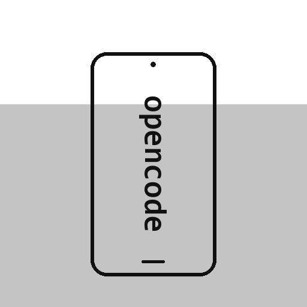

# OpenCode Mobile (Android / Kotlin)

<p align="center"></p>

Bilgisayarınızda çalışan OpenCode'a telefondan bağlanan yerel Android uygulaması.
TUI estetiğinde: koyu zemin, monospace yazılar, kutulu paneller.

## Özellikler

- **Bağlantı**: `opencode pair` / `opencode pair --remote` ile verilen bağlantıyı yapıştırın —
  uygulama sunucu adresini ve kodu otomatik ayrıştırır, token'ı alır.
  Aynı Wi-Fi şart değildir; OpenTunnel adresi uzaktan erişim için yeterlidir.
- **Session listesi**: başlık, dizin, güncelleme zamanı, maliyet, çalışır durum ve *başarısız*
  göstergesi; başlık/dizin araması ve *üst düzey / tümü / aktif / son 24s* filtresi.
  Alt ajan (subagent) oturumları `↳` ile işaretlenir ve varsayılan olarak gizlenir —
  *tümü* filtresiyle açılır (OpenCode her alt ajan çalıştırması için ayrı oturum kaydı açar).
- **Mesaj akışı**: kullanıcı/assistant mesajları, katlanabilir "düşünme" (reasoning) blokları,
  araç (tool) kartları — girdi/çıktı ayrıntısıyla, canlı akış sırasında da;
  model/sağlayıcı hataları mesaj içinde görünür.
- **Prompt girişi**: mesaj yazın, yanıt canlı aksın; çalışan görevi durdurma düğmesi.
- **Ajan & model seçimi**: oturum için ajan (build/…) ve model değiştirme.
- **Komutlar**: oturum ekranındaki "⌨ komutlar" düğmesi OpenCode'daki tüm komutları
  (`/init`, `/review`, uzantı komutları…) aranabilir listeler; isteğe bağlı bağımsız
  değişkenle doğrudan oturumda çalıştırır.
- **Kaydırma ile gezinme**: mesaj akışında sağa/sola kaydırınca önceki/sonraki oturuma geçilir.
- **Kapatma görevi**: ⏻ düğmesiyle "tüm oturumlar (alt ajanlar dahil) bitince bilgisayarı kapat"
  görevi kurulur. Görev "opencode-mobile" oturumu varsa ona, yoksa en son güncellenen oturuma
  **gözlemci prompt olarak** gönderilir ve bilgisayar tarafında yürütülür: oturum aktiflikleri
  boşalana kadar bekler, sonra kapatma komutunu (`shutdown.exe /s /t 120`, istenirse `/f` ile
  programları zorla kapatarak) **yalnızca bir kez** çalıştırır. Telefon kapalı olsa da uygulama
  kapalı olsa da sürer; iptal edilebilir (gözlemci oturuma iptal mesajı + kesme gönderilir).
- **Uzun basma menüleri**:
  - Oturum satırı: başlık/ID kopyalama, yeniden adlandırma, çoğaltma (fork), silme (onaylı).
  - Mesaj kartı: metni kopyalama, yanıta alıntı olarak ekleme, o noktaya kadar geri alma
    (`revert/stage` + `revert/commit`).
- **Soru kartları**: `question` aracıdan gelen etkileşimli formlar (seçenekli/serbest yanıt)
  doğrudan telefondan yanıtlanabilir.
- **İzin onayları**: "İzin isteği" kartında *bir kez / her zaman / reddet* düğmeleri.
- **Bildirimler**: uygulama arka plandayken izin isteği, soru ve görev bitişi bildirimleri.
- **Tema**: koyu / açık tema anahtarı (kalıcı).

## Kimlik doğrulama

OpenCode API'si HTTP Basic auth kullanır:

- kullanıcı adı: `opencode`
- parola: sunucu parolası **veya** pairing token'ı (ikisi de kabul edilir)

Uygulama pairing kodunu `GET /auth/connect/{code}` ile token'a çevirir ve saklar.

## Geliştirme

```powershell
# Araç zinciri bir kez (JDK 17 + Android SDK + Gradle):
powershell -ExecutionPolicy Bypass -File scripts\setup-toolchain.ps1

# Derle:
.\gradlew.bat assembleDebug

# Telefona kur (USB hata ayıklama açıkken):
adb install -r app\build\outputs\apk\debug\app-debug.apk
```

APK'yi dosya olarak da kurabilirsiniz: `app\build\outputs\apk\debug\app-debug.apk`
dosyasını telefona kopyalayıp açın (bilinmeyen kaynaklardan kurulum izni gerekir).

## Uzaktan erişim (OpenTunnel)

Bilgisayarda:

```powershell
opencode pair --remote
```

İlk kullanımda internete açmayı onaylamanızı ister. Çıkan bağlantıyı
(`https://....../auth/connect/....`) telefon uygulamasına yapıştırın.
Erişim sunucu parolasıyla korunur; trafik uçtan uca şifrelidir.

Parolayı değiştirmek için: `opencode service set password "uzun-bir-parola"`.

## Mimari

```
ui/            ConnectScreen, SessionsScreen, SessionScreen (Jetpack Compose)
net/Api.kt     HTTP API istemcisi + SSE olay akışı (OkHttp)
data/          DataStore ile bağlantı ayarları
AppViewModel   Durum yönetimi, canlı akış birleştirme
```

OpenCode API'si hakkında: https://opencode.ai/v2/docs/api